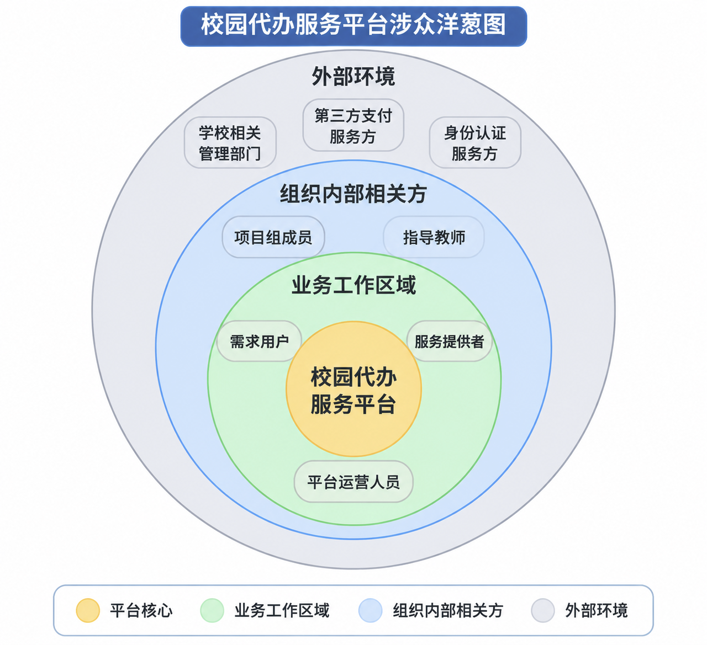

# 软件需求规格说明书

# 软件需求规格说明**书**

**项目名称：**校园代办服务平台
**文档规格：**软件需求规格说明书
**参考国家标准：**GB/T 9385—2008《计算机软件需求规格说明规范》

## 修订历史

|姓名|日期|变更原因|版本|
|---|---|---|---|
|张涛|2026年11月14日|初步编写软件需求规格说明书，整理产品范围、产品定位、用户特征及假设与依赖等内容。|V0\.1|
|||||
|||||

## 1\. 引言

> 本节应概述整篇文档。
> 
> 

### 1\.1 文档目的

说明本软件需求规格说明书的目的及其预期读者。

### 1\.2 产品范围

### （1）业务背景与项目目的

校园生活中，学生可能因为学习安排、时间冲突或距离等原因，无法及时完成部分日常事务，例如购买生活用品、领取快递或外卖等。目前，校园代办需求主要通过 QQ 群聊、QQ 频道等方式进行对接。

本项目拟设计并开发一个面向本校人员的校园代办服务平台，为有代办需求的用户和愿意提供服务的人员建立统一的任务对接渠道，改善代办任务的发布、承接和交付过程。

目前具体存在哪些突出问题，还需要通过平台试用和用户反馈进一步了解，不提前将未经验证的问题作为既定事实。

### （2）项目目标

参考教材第 5 章的 Purpose–Advantage–Measurement（目的—优势—衡量）方法，将项目目标分为以下三个部分：

### （3）预期附加价值

除完成基本的代办任务对接外，平台还可能带来以下附加价值：

1. \*\*促进校园互助：\*\*为有需求的学生和愿意提供帮助的学生建立联系，促进校园内部互助。

2. \*\*提供灵活服务机会：\*\*为有时间、有意愿的学生提供参与校园代办服务并获得服务报酬的机会。

3. \*\*提高信息透明度：\*\*通过统一记录任务信息和处理状态，使需求用户和服务提供者更容易了解任务进展。

4. \*\*改善校园生活服务：\*\*使校园代办需求和服务信息更加集中，有助于校园生活服务更加有序。

5. \*\*支持后续业务扩展：\*\*在现有代购、快递代取和外卖代取业务运行稳定后，可以根据实际需求考虑扩展其他服务。

以上内容属于项目预期产生的附加价值，不代表平台目前已经实现这些效果。

### （4）目标衡量指标

结合小组讨论结果，项目主要关注以下指标：

其中，任务完成率以已承接任务作为统计基数。具体统计周期、按时送达的判断方式和目标数值，可以在平台试用后进一步确定。

### （5）项目研究范围

本项目现阶段主要研究校园代购、快递代取和外卖代取业务，重点关注：

- 用户提出代购或代取需求；

- 代办任务信息的发布与传递；

- 服务提供者查看并承接任务；

- 代办任务的执行与状态反馈；

- 任务完成后的物品交付；

- 任务完成确认及相关评价或异常反馈。

本项目暂不将以下事项作为核心研究内容：

- 商家内部的商品库存、经营和订单管理；

- 快递站内部的入库、分拣和仓储管理；

- 第三方支付机构内部的资金清算；

- 学校内部的门禁、校园网络等基础设施管理。

平台是否需要接入相关外部服务，应根据后续调研和实际技术条件确定。

### 1\.3 定义、首字母缩略词与缩写

### 1\.4 参考资料

列出本软件需求规格说明书引用的所有其他文档或网址，可能包括用户界面风格指南、合同、标准、系统需求规格说明书、用例文档或愿景与范围文档。提供足够的信息，确保读者能够获取每份参考资料，包括标题、作者、版本号、日期以及来源或位置。

### 1\.5 文档概述

说明文档其余部分的内容及组织方式。

## 2\. 产品概述

> 本节应描述影响产品及其需求的总体因素。本节不规定具体需求，而是为这些需求提供背景；具体需求将在第3节中详细定义，本节旨在使其更易于理解。
> 
> 

### 2\.1 产品定位

### （1）所属业务领域

本项目属于校园生活服务领域，具体聚焦于校园代办服务。

校园代办服务是指在校园生活场景中，由有需求的用户提出代办任务，并由其他服务提供者按照任务要求完成相应事务的服务活动。

现阶段，平台主要涉及以下三类业务：

- \*\*代购业务：\*\*需求用户提出商品购买要求，服务提供者根据要求完成购买并交付。

- \*\*快递代取业务：\*\*需求用户提出快递领取要求，服务提供者按照约定完成领取并交付。

- \*\*外卖代取业务：\*\*需求用户提出外卖领取要求，服务提供者按照约定完成领取并交付。

### （2）领域主要参与角色

校园代办业务主要涉及以下角色：

第三方支付服务方和身份认证服务方属于平台需要对接的外部服务方，不属于直接参与代办任务的业务角色。

商家和快递站不属于本平台管理范围，不作为本项目的平台涉众。

### （3）主要业务对象

校园代办业务涉及以下主要业务对象：

### （4）主要业务过程

从业务角度看，校园代办活动可以概括为：

1. 需求用户产生代购或代取需求。

2. 需求用户向平台提交任务信息。

3. 服务提供者查看任务并自主决定是否承接。

4. 服务提供者根据任务要求执行代办。

5. 服务提供者反馈任务进度及完成情况。

6. 服务提供者完成物品交付。

7. 需求用户确认任务完成，并根据需要进行评价或反馈。

该过程描述的是业务活动，不限定平台必须采用某种特定技术实现方式。

### （5）领域边界

本项目的研究重点是需求用户、服务提供者与平台之间的代办任务协作过程。

平台主要负责代办任务信息的发布、承接、进度反馈、交付确认及相关管理工作。商家和快递站等不属于本平台的直接管理范围，其内部业务流程不纳入本项目的核心研究内容。

---

## 

### 2\.2 产品功能

概述产品必须执行或必须支持用户执行的主要功能。详细内容将在第3节给出，因此此处只需提供高度概括的说明（如项目符号列表）。应合理组织这些功能，使本软件需求规格说明书的任何读者都能理解。展示主要相关需求组及其关系的图示（如顶层数据流图或对象类图）通常很有帮助。

### 2\.3 产品约束

本小节应总体描述所有会限制开发人员选择的事项，可能包括：

- 与用户、其他应用程序或硬件的接口。

- 服务质量约束。

- 标准合规要求。

- 设计或实现方面的约束。

### 2\.4 用户特征

### （1）涉众识别

涉众（Stakeholders）是指参与项目相关工作、受到项目影响，或对项目具有利益诉求和影响力的个人或组织。

结合目前的平台业务范围，识别出以下涉众：

### （2）主要用户特征与优先级

本项目的核心用户是需求用户和服务提供者，两类用户都直接参与平台的主要业务流程。

- \*\*需求用户：\*\*主要是有代购、快递代取或外卖代取需求的本校学生。其关注点是任务发布是否方便、任务信息能否准确传达，以及物品能否按照指定时间和地点完成交付。

- \*\*服务提供者：\*\*主要是愿意利用空闲时间提供代办服务的本校学生。其关注点是任务信息是否完整、费用是否明确、能否自主选择任务，以及任务完成后能否得到确认。

- \*\*平台运营人员：\*\*由指定人员负责平台运营，主要关注用户管理、任务管理、异常处理和投诉处理等工作。

- \*\*学校相关管理部门：\*\*主要提出平台运营方面的管理要求，并监督平台是否符合相关规定。

从需求获取优先级来看，建议优先关注需求用户和服务提供者，再根据实际情况了解平台运营人员及外部服务方的需求。

### （3）涉众利益与影响

不同涉众对平台有不同的利益诉求，同时也会对项目产生不同程度的影响。

### （4）涉众优先级

根据各涉众与平台业务的关系及其对项目的影响，将涉众优先级划分如下：

### （5）涉众洋葱图

参考教材第 5 章的 Stakeholder Map（涉众地图，也称 Onion Diagram，洋葱图），以预期解决方案为中心，根据涉众与解决方案及组织环境之间的关系进行分层。

本项目洋葱图的中心为校园代办服务平台，外围根据角色与平台的关系划分为业务工作区域、组织内部其他相关方和外部环境。

目前初步确定：

- \*\*中心：\*\*校园代办服务平台。

- \*\*业务工作区域：\*\*需求用户、服务提供者、平台运营人员。

- \*\*组织内部其他相关方：\*\*项目组成员、课程指导教师等。

- \*\*外部环境：\*\*学校相关管理部门、第三方支付服务方、身份认证服务方。

**图 2\-1 校园代办服务平台涉众洋葱图**

各层具体说明如下：

说明：目前暂将指导教师放在“组织内部其他相关方”这一层；如果课程教材示例或老师给出的洋葱图有不同划分，再按其要求调整。学校管理部门只负责提出管理要求和监督，不参与日常订单管理。

---

## 

### 2\.5 假设与依赖

本平台的需求和正常运行依赖以下假设及外部条件：

### （1）用户身份认证依赖

假设平台用户为本校人员，平台需要具备用户身份验证条件。身份认证方式可能采用学校统一认证或学号信息认证等方式，具体方式尚待项目组确定。

如果无法获得合适的身份认证方式，可能影响平台对用户身份的验证。

### （2）第三方支付服务依赖

平台涉及商品费用和代办服务费，需要依赖第三方支付服务完成相关支付操作。

具体支付服务商、支付方式和接入方式尚待项目组结合实际技术条件确定。如果第三方支付服务无法正常使用，可能影响平台相关支付业务。

### （3）校园管理规定

平台仅面向本校人员提供服务，服务区域为本校校园内。平台运营需要符合学校相关管理规定，并接受学校相关管理部门的监督。

快递和外卖代取需要遵守相应的领取授权要求及校园管理规定。

### （4）代购商品范围

平台代购商品不得涉及违法物品，主要面向生活用品、餐饮及校园内常用物品。具体商品范围需要符合相关法律法规和校园管理要求。

### （5）任务费用与完成确认

任务费用由商品费用和代办服务费构成。任务完成后，需要由需求用户确认任务完成。

上述业务规则是平台业务正常开展的基本条件，后续具体处理方式需要结合平台需求进一步明确。

### （6）网络与运行环境

平台正常使用依赖可用的网络及相应运行环境。具体运行环境和相关技术条件由项目组后续确定。

### 2\.6 需求分配

将软件需求分配到各个软件元素。对于需要由多个软件元素共同实现的需求，或最初尚未确定分配给哪个软件元素的需求，应予以说明。应使用按功能和软件元素编制的交叉引用表汇总需求分配情况。

明确可能推迟到系统未来版本（如分块和/或增量版本）实现的需求。

## 3\. 需求

> 本节规定软件产品的需求。所有软件需求均应足够详细，使设计人员能够设计出满足这些需求的软件系统，并使测试人员能够验证软件系统是否满足这些需求。
> 
> 

> 具体需求应：
> 
> 

- 具有唯一标识。

- 明确需求的主体（如系统、软件等）以及应执行的事项。

- 视情况说明相关条件和约束（如有）。

- 描述软件系统的每项输入（激励）、每项输出（响应），以及软件系统为响应输入或支持输出而执行的所有功能。

- 可验证（例如，能够向客户证明需求已实现，并使其满意）。

- 遵循约定的语法、关键词和术语。

### 3\.1 外部接口

> 本小节定义软件系统的所有输入和输出需求。所定义的每个接口可包括以下内容：
> 
> 

- 条目名称

- 输入来源或输出目的地

- 有效范围、精度和/或容差

- 计量单位

- 时序

- 与其他输入/输出的关系

- 屏幕格式/布局

- 窗口格式/布局

- 数据格式

- 命令格式

- 结束消息

#### 3\.1\.1 用户界面

明确需要用户界面的软件组件。描述软件产品与用户之间每个接口的逻辑特征，可包括示例屏幕图像、需遵循的图形用户界面标准或产品系列风格指南、屏幕布局约束、每个屏幕均显示的标准按钮和功能（如帮助）、键盘快捷键、错误消息显示标准等。用户界面设计的详细信息应记录在单独的用户界面规格说明书中。

可进一步划分为易用性需求和便利性需求。

#### 3\.1\.2 硬件接口

描述软件产品与系统硬件组件之间每个接口的逻辑和物理特征，可包括支持的设备类型、软件与硬件之间数据和控制交互的性质，以及所使用的通信协议。

#### 3\.1\.3 软件接口

描述本产品与其他特定软件组件（名称和版本）之间的连接，包括数据库、操作系统、工具、库和集成的商业组件。明确传入和传出系统的数据项或消息，并说明各自的用途。描述所需的服务及通信性质。引用描述详细应用程序编程接口协议的文档。明确将在软件组件之间共享的数据。如果数据共享机制必须以特定方式实现（例如，在多任务操作系统中使用全局数据区），应将其规定为实现约束。

### 3\.2 功能需求

> 本节规定待开发软件应对其环境产生的功能效应需求。
> 
> 

### 3\.3 服务质量

> 本节规定软件的功能效应应具备的其他质量相关属性需求。
> 
> 

#### 3\.3\.1 性能

如果产品在各种情况下存在性能需求，应在此说明并解释其依据，帮助开发人员理解意图并作出适当的设计选择。明确实时系统的时序关系。此类需求应尽可能具体，可能需要针对单项功能需求或特性分别规定性能需求。

#### 3\.3\.2 安全性

规定与产品使用或产品所使用、创建的数据保护有关的任何安全或隐私需求。明确所有用户身份认证需求。引用影响产品的、包含安全要求的外部政策或法规。明确必须满足的安全或隐私认证要求。

#### 3\.3\.3 可靠性

规定为确保软件系统在交付时达到所需可靠性而必须考虑的因素。

#### 3\.3\.4 可用性

规定为确保整个系统达到既定可用性水平所需的因素，如检查点、恢复和重启。

### 3\.4 合规性

规定由现行标准或法规衍生的需求，包括：

- 报告格式

- 数据命名

- 会计程序

- 审计追踪

例如，可在此规定软件追踪处理活动的需求。某些应用程序需要此类追踪，以满足最低监管或财务标准。例如，审计追踪需求可规定：工资数据库的所有更改均应记录在追踪文件中，并记录更改前后的值。

### 3\.5 设计与实现

#### 3\.5\.1 安装

为确保待开发软件在目标实现平台上顺利运行而应遵守的约束。

#### 3\.5\.2 分布

为使软件组件适应宿主组织的地理分布结构、待处理数据的分布或受控设备的分布而应遵守的约束。

#### 3\.5\.3 可维护性

规定与软件自身维护便利性相关的属性，可包括对模块化、接口或复杂度限制的需求。不应仅因某些内容被认为是良好的设计实践，就将其作为需求放在此处。

#### 3\.5\.4 可复用性

\<\!\-\- 待办：补充描述 \-\-\>

#### 3\.5\.5 可移植性

规定与软件迁移到其他宿主机器和/或操作系统的便利性相关的属性。

#### 3\.5\.6 成本

规定软件产品的货币成本。

#### 3\.5\.7 交付期限

规定软件产品的交付时间安排。

#### 3\.5\.8 概念验证

\<\!\-\- 待办：补充描述 \-\-\>

## 4\. 验证

> 本节提供计划用于鉴定软件的验证途径和方法。建议采用与第3节需求条目相对应的方式给出验证信息项。验证过程的目的是提供客观证据，证明系统或系统元素满足其规定的需求和特性。
> 
> 

\<\!\-\- 待办：参照第3节提供更多指导 \-\-\>

\<\!\-\- 电气与电子工程师协会标准 15288:2015 \-\-\>

## 5\. 附录

> （注：部分内容由豆包工作 AI 生成）
